# Notification Service – SIS #2 (gRPC implementation)

Java implementation of the Notification Service interface from SIS #1 using **gRPC (HTTP/2)**, with
**idempotency, timeouts and retries**, plus measurements of **latency and payload size against a REST/JSON baseline**.

> Diagrams are written in [Mermaid](https://mermaid.js.org/). They render automatically on GitHub/GitLab and in
> VS Code (extension "Markdown Preview Mermaid Support"). Measured numbers are in [`REPORT.md`](REPORT.md).

---

## 1. The big picture

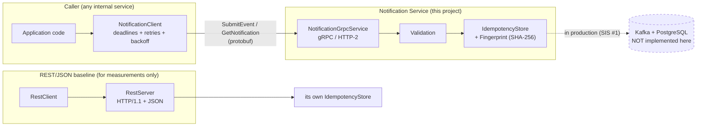

**What is real and what is simulated**

| Part | Status |
|---|---|
| gRPC interface, client, server | Implemented |
| Idempotency on `event_id` | Implemented (in-memory map standing in for Kafka ACK + `UNIQUE(event_id)`) |
| Timeouts, retries, backoff with jitter | Implemented |
| REST/JSON baseline, benchmark, fault injection | Implemented |
| Kafka, PostgreSQL, providers, TLS, JWT | Not implemented (outside SIS #2) |

---

## 2. Project layout

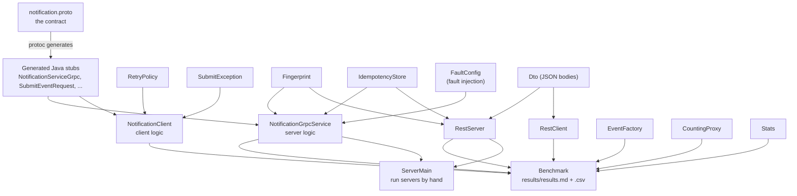

| File | Role |
|---|---|
| `src/main/proto/notification.proto` | Service contract: 2 RPCs, request/response messages, enums |
| `NotificationGrpcService` | Server: validates, deduplicates, answers; optional fault injection |
| `NotificationClient` | Client: per-attempt + overall deadline, retry loop, same `event_id` on every retry |
| `RetryPolicy` | Retry settings, which status codes are retryable, jittered backoff formula |
| `SubmitException` | Final failure: gRPC status + number of attempts used |
| `IdempotencyStore` | Atomic "first writer wins" per `event_id`, counters (created / duplicate / conflict) |
| `Fingerprint` | SHA-256 of the event content, to tell a retry from a client bug |
| `FaultConfig` | Probabilities of injected failures (for tests and the reliability experiment) |
| `RestServer`, `RestClient`, `Dto` | REST/JSON baseline with the same logic and store type |
| `CountingProxy` | TCP proxy that counts the real bytes on the wire |
| `EventFactory`, `Stats` | Same events for both protocols, percentile calculation |
| `Benchmark` | Runs all measurements |
| `ServerMain` | Starts gRPC `:50051` and REST `:8080` for manual testing |
| `NotificationServiceTest` | 7 JUnit 5 tests |

---

## 3. The contract (SIS #1 REST → gRPC)

| SIS #1 REST | gRPC | Notes |
|---|---|---|
| `POST /v1/notification-events` → 202 | `SubmitEvent` → OK (`status = QUEUED`) | OK means the event has been accepted/enqueued |
| `GET /v1/notifications/{id}` → 200 | `GetNotification` → OK | |
| 404 | `NOT_FOUND` | unknown `event_id` |
| 400 | `INVALID_ARGUMENT` | missing field, unspecified channel |
| 409 | `ALREADY_EXISTS` | same `event_id`, different content |
| 429 | `RESOURCE_EXHAUSTED` | retryable |
| 503 | `UNAVAILABLE` | retryable |
| client timeout | `DEADLINE_EXCEEDED` | retryable (safe because of idempotency) |

---

## 4. How one request works (happy path)

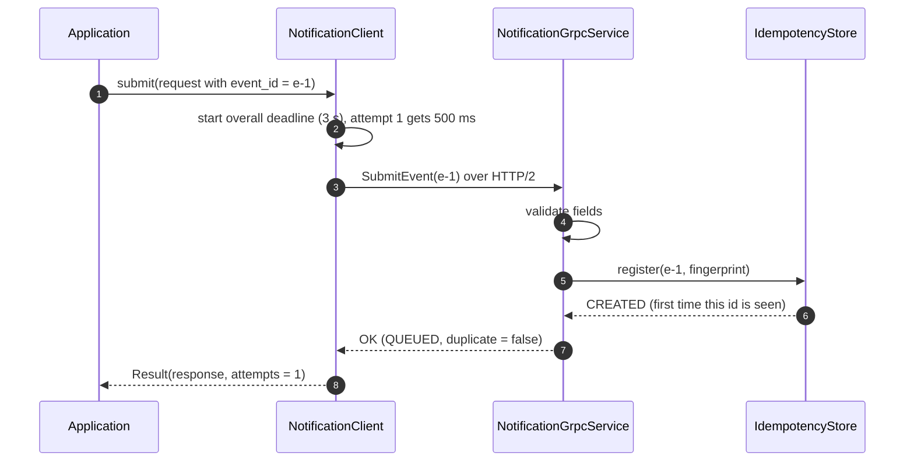

Inside the server, every request goes through the same decision steps, in this order:

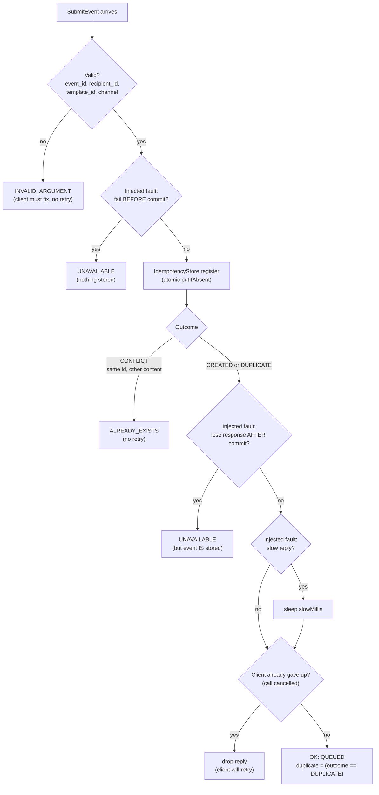

---

## 5. Idempotency: how duplicates are handled

The caller picks the `event_id` and **re-sends the exact same request on every retry**. The server remembers
each `event_id` together with a SHA-256 fingerprint of the content.

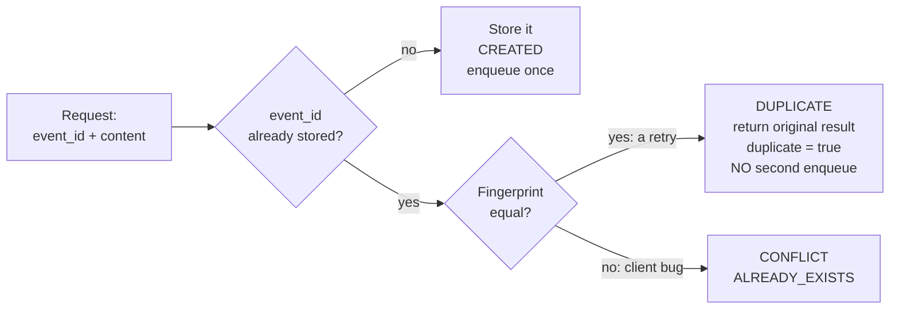

| Situation | Server outcome | Client sees | Enqueued again? |
|---|---|---|---|
| New `event_id` | `CREATED` | OK, `duplicate=false` | yes (once) |
| Same id, same content (retry) | `DUPLICATE` | OK, `duplicate=true` | **no** |
| Same id, different content | `CONFLICT` | `ALREADY_EXISTS` | no |

`register()` uses `ConcurrentHashMap.putIfAbsent`, so two retries that arrive at the same moment cannot both be `CREATED`.

---

## 6. Timeouts and retries

### 6.1 The client loop

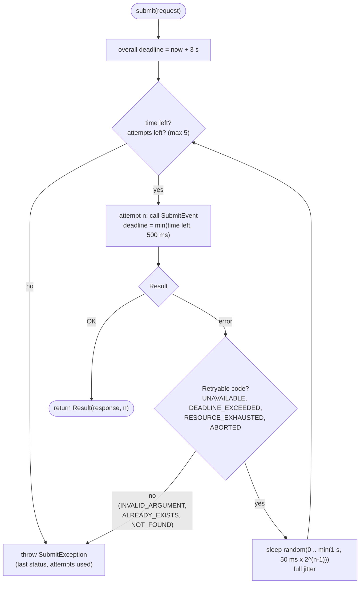

Default `RetryPolicy`: 5 attempts · 500 ms per attempt · 3 s overall · backoff 50 ms ×2 up to 1 s · full jitter.
Jitter spreads retries out, so many clients that fail at the same moment do not all retry at the same moment.

### 6.2 Why retrying is safe: three failure cases

**Case A: failure before the event was stored.** The retry simply succeeds.

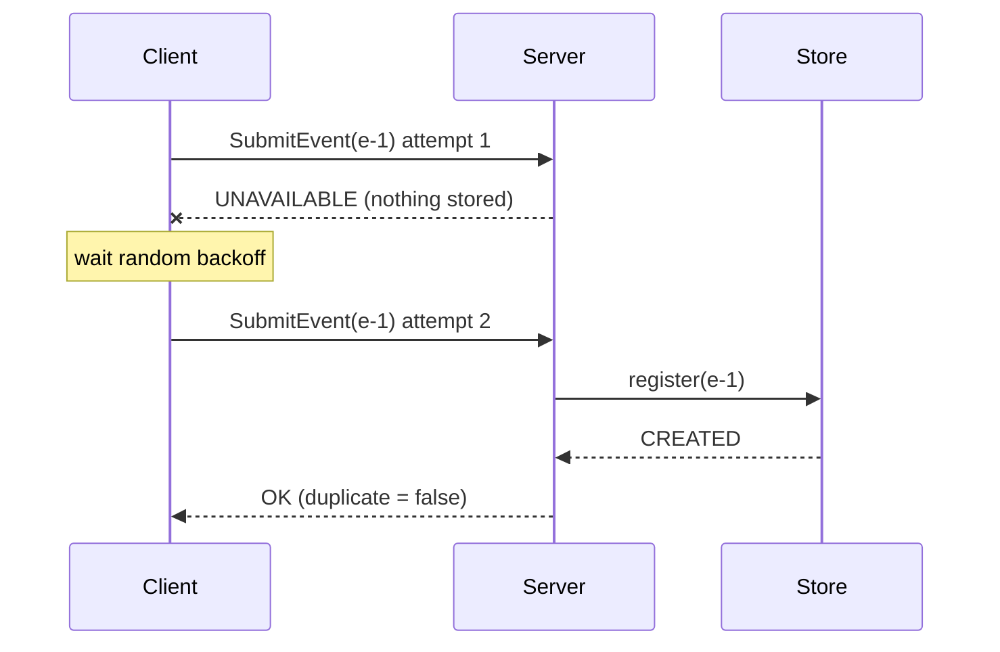

**Case B: the response is lost after the event was stored.** This is the dangerous case, and idempotency handles it.

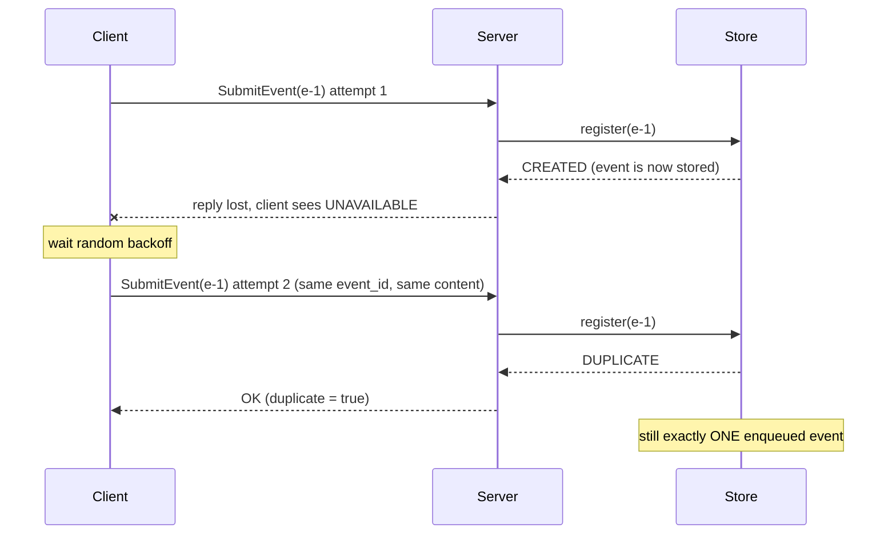

**Case C: the server is slower than the deadline.**

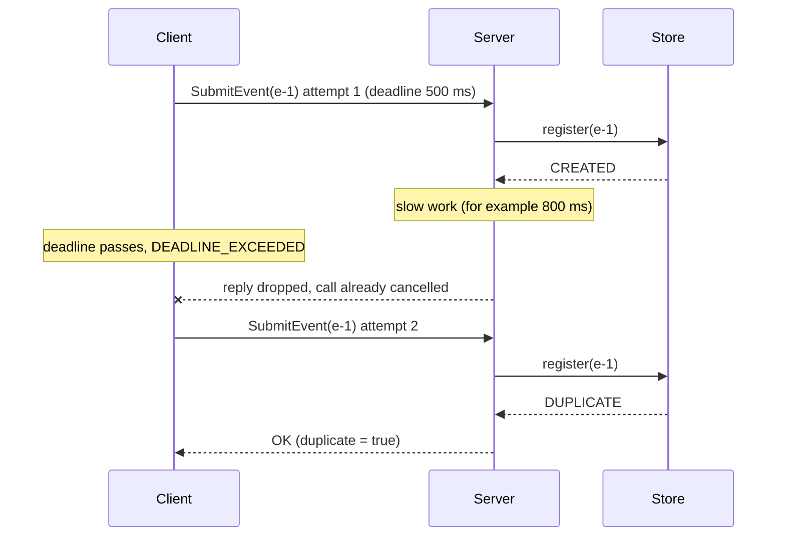

> **Important:** if `submit()` finally throws, the event may **still have been stored** (cases B and C). The caller
> should retry later with the **same** `event_id`, never assume "failed = not delivered". This matches the
> at-least-once guarantee of SIS #1.

---

## 7. How the measurements work

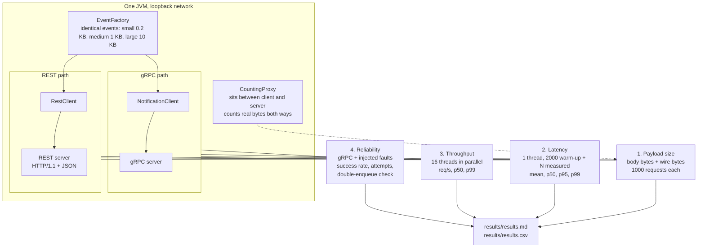

How the wire-size measurement works: the client talks to the proxy, the proxy forwards to the server and counts every byte.

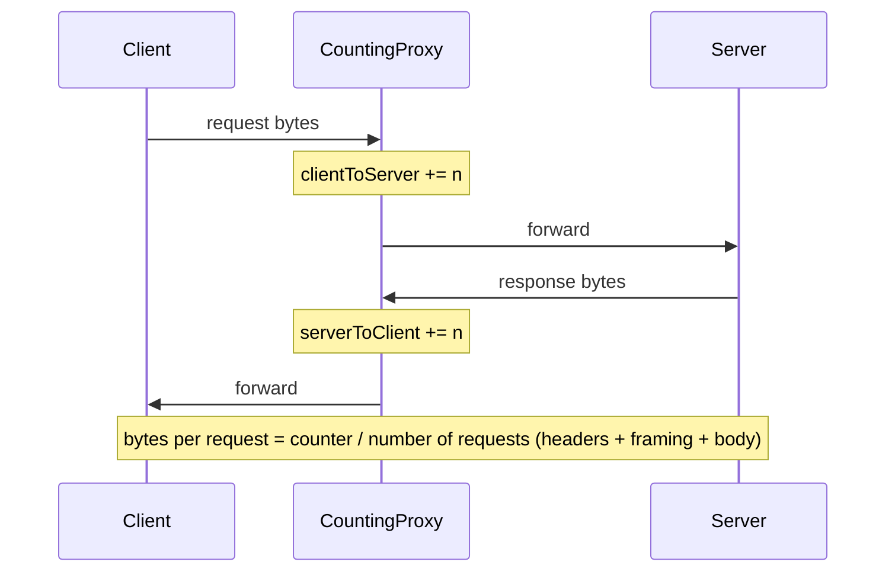

**Fairness rules used**

* Same events and the same server logic (validation, fingerprint, store) on both paths.
* Objects are built *before* timing, and (de)serialization is *inside* the timed region for both protocols.
* Warm-up requests before measuring, unique `event_id` for every request.
* `TCP_NODELAY` enabled on the JDK REST server (otherwise Nagle + delayed ACK adds ~40 ms, which is a JDK artefact, not a cost of REST).

### Fault-injection experiment (section 4 of the results)

Each request to the test server can randomly: fail **before** commit (15 %), lose its response **after** commit (15 %), or reply
slower than the client deadline (5 %). The check at the end: *events enqueued on the server == distinct events submitted*, i.e. **0 double-enqueues**.

---

## 8. What each test proves

| Test | Proves |
|---|---|
| `sameEventTwice_isEnqueuedOnce` | A duplicate is recognised (`duplicate=true`), enqueued once |
| `sameIdDifferentPayload_isRejected_andNotRetried` | `ALREADY_EXISTS`, exactly 1 attempt |
| `invalidRequest_isRejected_andNotRetried` | `INVALID_ARGUMENT`, exactly 1 attempt |
| `lostResponse_isRetried_withoutDoubleEnqueue` | 4 attempts, 1 enqueue, 3 recognised duplicates (case B) |
| `transientFailureBeforeCommit_isRetriedAndSucceeds` | 50 events, 50% pre-commit failures, all succeed once (case A) |
| `slowServer_hitsDeadline_thenRetries_withoutDoubleEnqueue` | `DEADLINE_EXCEEDED` after 2 attempts, still 1 enqueue (case C) |
| `getNotification_returnsStatus_or_notFound` | Status lookup and `NOT_FOUND` |

---

## 9. How to run

Requirements: **JDK 17+**, **Maven 3.8+**, internet on the first run. Run all commands from this folder (where `pom.xml` is).

```bash
mvn test                                   # 7 tests, expect: Tests run: 7, Failures: 0, BUILD SUCCESS
mvn compile exec:java                      # benchmark, ~1-3 min -> results/results.md + results.csv
mvn compile exec:java -Dexec.args="--requests=10000 --threads=32 --wire=2000"   # bigger sample
mvn compile exec:java -Dexec.mainClass=notification.ServerMain                   # gRPC :50051 + REST :8080
```

Benchmark options: `--requests` (measured per cell), `--warmup`, `--threads`, `--wire`, `--out`.

Manual REST check (while `ServerMain` is running):

```bash
curl -i -X POST localhost:8080/v1/notification-events -H "Content-Type: application/json" \
  -d '{"event_id":"e-1","recipient_id":"u1","channel":"EMAIL","template_id":"welcome","data":{"name":"Aidar"}}'
```

Send it twice → both 202, one enqueue. Change `template_id` and resend → 409.

---

## 10. Results at a glance

Measured in a 1-CPU sandbox (see [`REPORT.md`](REPORT.md) for full tables and limitations). Re-run on your machine.

| | small (~0.2 KB) | medium (~1 KB) | large (~10 KB) |
|---|---|---|---|
| Wire bytes, gRPC vs REST | **−40 %** | **−14 %** | ≈ −1 % |
| Median latency, gRPC vs REST | ≈ −45 % | ≈ −50 % | ≈ −44 % (inconsistent between runs) |
| p99 latency | no clear difference | no clear difference | no clear difference |
| Throughput | no clear difference | no clear difference | no clear difference |

Reliability: with ~35 % injected failures per attempt, 99.85 % of events still succeeded and **0 were enqueued twice**.

## 11. Limitations

* In-memory store instead of Kafka + PostgreSQL; no TLS and no JWT/API key.
* Client, servers and proxy share one JVM and loopback, so there is no real network latency.
* The REST baseline is HTTP/1.1 on the JDK's built-in server, not a tuned stack.
* Differences below ~10 % between runs should not be treated as real.
