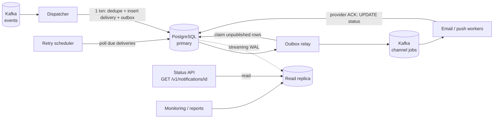
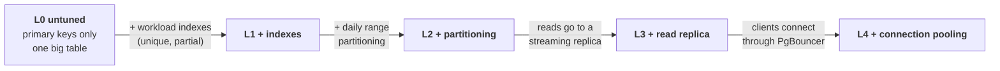
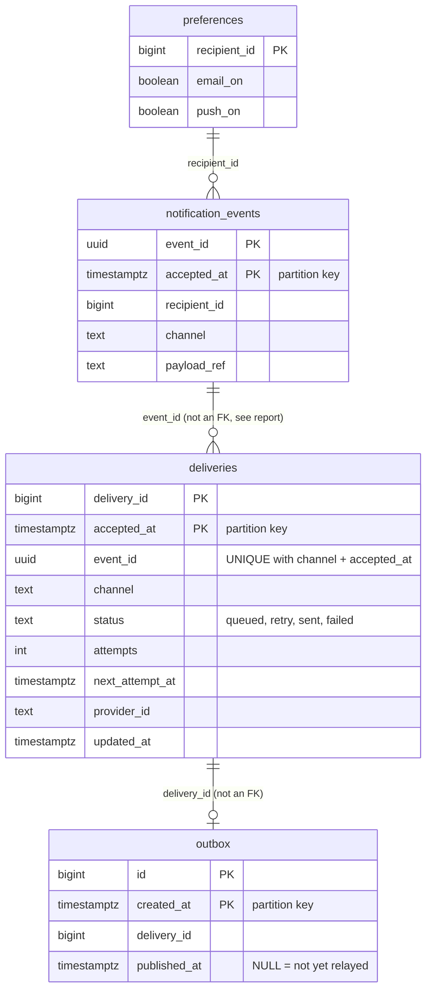
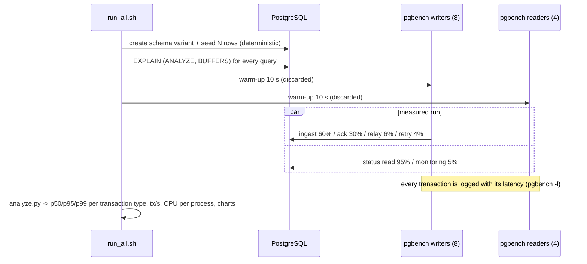

# Notification Service – SIS #3: Database tuning (PostgreSQL)

Schema, indexes, `EXPLAIN ANALYZE`, partitioning, a streaming **read replica** and **connection pooling (PgBouncer)** for the
Notification Service from SIS #1, with a **before/after benchmark (p95 / p99)** and an explanation of every gain.

---

## 1. What is being tuned (workload taken from SIS #1)



| # | Query (script in `bench/`) | Who runs it | Tables | Why it is hot |
|---|---|---|---|---|
| 1 | `ingest.sql` – dedupe + insert event, delivery, outbox (one txn) | Dispatcher | events, deliveries, outbox, preferences | every event, 3,000/s at peak |
| 2 | `update.sql` – provider ACK, `UPDATE … WHERE delivery_id = ?` | Workers | deliveries | every delivery |
| 3 | `relay.sql` – claim 50 unpublished rows `FOR UPDATE SKIP LOCKED` | Outbox relay | outbox | continuous polling |
| 4 | `retry.sql` – claim 50 due deliveries | Retry scheduler | deliveries | continuous polling |
| 5 | `read_status.sql` – `WHERE event_id = ?` | Status API | deliveries | user-facing reads |
| 6 | `monitor.sql` – status counts for a time window | Dashboards / alerts | deliveries | scans a time range |

## 2. The optimisation ladder (one change per step, same workload every time)



Separate side experiments: partition-aware reads, 200 concurrent client connections (pooling), connect-per-request cost,
replication visibility delay, and retention (`DELETE` vs `DROP PARTITION`).

## 3. Schema (S2, final)



Indexes: `UNIQUE (event_id, channel, accepted_at)` · partial `(next_attempt_at) WHERE status IN ('queued','retry')` ·
`(accepted_at)` · partial `outbox (id) WHERE published_at IS NULL`. Details and reasons in the report.

## 4. Run it

**Requirements:** PostgreSQL 16 (server + `pgbench` + `pg_basebackup`), PgBouncer ≥ 1.21, Python 3 with `matplotlib` and `psycopg2-binary`, `bc`.
Run as a normal (non-root) user. About 5 GB of free disk and 4 GB RAM. Everything runs locally; it creates its own clusters under `~/sis3-data`
(ports 5432 primary, 5433 replica, 6432 PgBouncer) and does not touch an existing installation unless it uses those ports.

```bash
# Ubuntu/Debian                                   # macOS (Homebrew)
sudo apt install postgresql-16 pgbouncer bc        # brew install postgresql@16 pgbouncer
pip install matplotlib psycopg2-binary             # export PGBIN="$(brew --prefix postgresql@16)/bin"
# on Ubuntu the packages auto-start a default cluster on 5432:  sudo pg_ctlcluster 16 main stop

cd sis3-database-tuning
./scripts/run_all.sh                               # full experiment, ~20 minutes -> results/
```

Smaller smoke run (about 8 minutes; `DURATION` must be above 16 s because CPU is sampled between seconds 8 and DURATION-8):

```bash
N=200000 DURATION=20 DURATION_S0=20 WARMUP=3 HIGH_CLIENTS=60 ./scripts/run_all.sh
```

If your machine is flaky or you want to run it in pieces, the experiment is split into resumable stages:

```bash
STAGES="s0 s1"      ./scripts/run_all.sh   # untuned schema, then indexes on the same data  (~9 min)
STAGES="s2"         ./scripts/run_all.sh   # partitioning + replica + PgBouncer + pooling   (~10 min)
STAGES="analyze"    ./scripts/run_all.sh   # rebuild results/summary.md and charts from the raw logs
```

Settings (all overridable as environment variables, see `config.sh`): `N` seeded deliveries (default 2,000,000), `DURATION` (45 s), `DURATION_S0` (180 s),
`WRITE_CLIENTS` (8), `READ_CLIENTS` (4), `HIGH_CLIENTS` (200), `POOL_SIZE` (20), `PGBIN`, `SIS3_HOME`.

Stop everything afterwards: `./scripts/teardown.sh`.

### Try pieces by hand

```bash
./scripts/setup_primary.sh                      # start the primary
createdb -h 127.0.0.1 notif
psql -h 127.0.0.1 notif -f sql/schema_s0_untuned.sql
psql -h 127.0.0.1 notif -v n=200000 -v anchor=$(date -u -d 'today 00:00' +%s) -f sql/seed.sql
psql -h 127.0.0.1 notif -f sql/schema_s1_indexes.sql
psql -h 127.0.0.1 notif -v n=200000 -v anchor=$(date -u -d 'today 00:00' +%s) -f sql/explain.sql   # query plans
```

(macOS: replace `date -u -d 'today 00:00' +%s` with `date -u -j -f "%Y-%m-%d %H:%M:%S" "$(date -u +%Y-%m-%d) 00:00:00" +%s`.)

## 5. How a benchmark step works



* **Closed-loop clients:** each client sends the next transaction as soon as the previous one finishes, so p95/p99 include queueing under load.
* **Same data:** the seed is deterministic (`md5(n)::uuid`, timestamps spread over 7 days), so duplicate replays hit existing rows and every step starts from the same content.
* **Durability is never traded for speed:** `synchronous_commit = on` for every measured run (it is only switched off inside the bulk-load seed).

## 6. Layout

| Path | Content |
|---|---|
| `REPORT.md` | The write-up: analysis of query plans and an explanation of every gain |
| `config.sh` | All tunables (ports, sizes, durations) |
| `sql/schema_s0_untuned.sql`, `schema_s1_indexes.sql`, `schema_s2_partitioned.sql` | The three schema variants |
| `sql/seed.sql` | Deterministic data generator |
| `sql/explain.sql`, `sql/index_size.sql` | `EXPLAIN ANALYZE` of every query; composite vs partial index comparison |
| `sql/retention_delete.sql`, `sql/retention_drop.sql` | 7-day retention: `DELETE` vs `DROP PARTITION` |
| `bench/*.sql` | pgbench transaction scripts (one per workload query) |
| `scripts/setup_*.sh` | Primary, replica (`pg_basebackup`), PgBouncer (transaction mode) |
| `scripts/run_all.sh`, `scripts/lib.sh` | Orchestration |
| `scripts/connect_cost.py`, `scripts/replica_visibility.py` | Connection cost and replication-delay probes |
| `analysis/analyze.py` | Logs → percentiles, tables, charts |
| `results/` | Output of the run submitted with this project |
